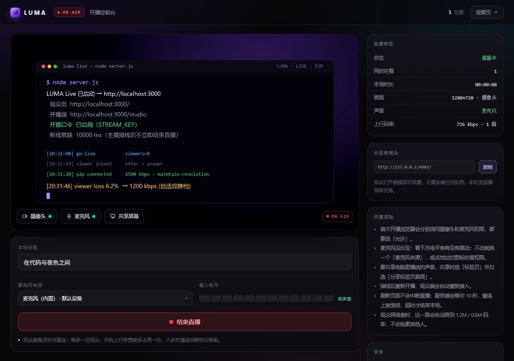
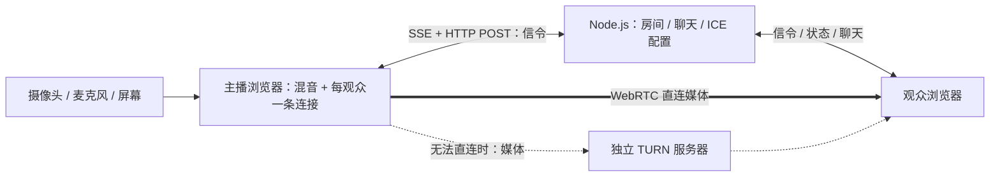

<div align="center">

# LUMA Live

**浏览器互连的轻量直播间：打开开播台，把观众页分享给朋友。**

无需 OBS、RTMP 或转码服务 · Node.js 服务端零第三方运行时依赖


[快速开始](#快速开始) · [界面](#界面) · [安装与部署](#安装与部署) · [安全与运维](#安全与运维) · [TURN 中继](#turn-中继) · [工作原理](#工作原理) · [验证与限制](#验证与限制)

</div>

## 能做什么

- **浏览器开播**：摄像头、麦克风、屏幕共享，以及 WebAudio 混音。
- **链接观看**：观众无需安装客户端，浏览器播放并实时聊天。
- **帧率优先的自适应画质**：目标 30 fps，根据链路与编码负载逐观众调节分辨率和 2.5 / 1.2 / 0.6 Mbps 码率上限。
- **轻量信令服务**：SSE + HTTP POST，维护房间、聊天与断线宽限状态。
- **可选 TURN**：下发临时中继凭证，识别中继链路并限制码率。

> **适合小范围分享，不是大规模直播平台。** 每位观众都从主播接收一份媒体流；可承载人数取决于主播上行、设备、网络及部署环境，没有统一的「150 人上限」。延迟和连通性也不作固定保证。真实公网 TURN relay 链路尚未完成验证，详见[验证与限制](#验证与限制)。

## 快速开始

**只有运行服务的机器需要准备环境；主播和观众使用浏览器。** 本地启动不会自动获得公网地址，`localhost` 也不能直接分享给别人。

### Windows：下载、解压、双击

1. 在仓库顶部选择 **Code → Download ZIP**。
2. 完整解压到一个普通文件夹，例如 `C:\luma-live`，确认其中有 `server.js` 和 `start.bat`。不要在压缩包内运行。
3. 双击 **`start.bat`**。缺少 Node.js 时，脚本会打开下载页；安装 LTS 版本后重新运行脚本。
4. 浏览器自动打开 `http://localhost:3000/studio`，授权摄像头和麦克风，再开始直播。
5. 同一局域网的观众打开 `http://<你的内网IP>:3000/`。跨网络分享需要公网 HTTPS 地址，见[安装与部署](#安装与部署)。

保持命令窗口和主播页面开启；关闭窗口会停止服务。已有 Node.js ≥ 18 时，也可以在项目目录执行 `node server.js`。建议使用仍受维护的 Node.js LTS 版本。

### macOS / Linux / Docker

```bash
# 原生运行：先安装 Node.js ≥ 18
git clone https://github.com/ko2en/luma-live.git
cd luma-live
bash start.sh
```

或在已安装 Docker 的机器上运行（Windows 同样适用）：

```bash
git clone https://github.com/ko2en/luma-live.git
cd luma-live
docker compose up -d
```

启动后，开播台为 `http://localhost:3000/studio`，观众页为 `http://localhost:3000/`。

### 自行部署到 Render

[](https://render.com/deploy?repo=https://github.com/ko2en/luma-live)

这是**部署你自己的实例**，不是在线体验入口。按平台提示连接仓库、设置 `STREAM_KEY` 并完成部署，使用平台分配的 HTTPS 地址访问。额度、休眠、费用及并发限制以平台实际规则为准；仓库的 `render.yaml` 只是部署起点，不代表可用性或容量承诺。

其他托管环境可使用仓库内的 `Dockerfile`，或启动 `node server.js`；需支持常驻 Node.js 进程和 SSE 长连接。HTTP 托管实例与 TURN 中继是两项独立部署。

> 公网使用前，请先设置足够长、随机的 `STREAM_KEY` 并启用 HTTPS。不设口令时，任何能访问开播接口的人都可能开播或替换当前主播。

## 界面

### 开播控制台



### 观众页

桌面布局包含播放器与聊天区，窄屏切换为单列。


## 安装与部署

### 先分清三种角色

| 角色 | 需要什么 | 必须保持在线的内容 |
|---|---|---|
| 应用服务器 | 项目文件与 Node.js，或 Docker | 服务进程；负责网页、信令、房间状态和聊天 |
| 主播 | 支持采集的浏览器；使用 `localhost` 或 HTTPS | 主播页面与媒体设备；逐个向观众发送媒体 |
| 观众 | 能访问观众页的浏览器 | 观众页面；无需安装 Node.js |

应用服务器可以是你的 Windows 电脑，也可以是云服务器。**把服务放到云端，不会替主播分发媒体，也不会让主播关掉页面后继续直播。**

| 部署位置 | 适合场景 | 对外访问与成本 |
|---|---|---|
| 自己的电脑 | 本机测试、局域网分享 | 外网需额外配置隧道或公网入口；电脑不能休眠 |
| 云服务器 / 托管实例 | 需要稳定的网页访问地址 | 需 HTTPS；费用、休眠与长连接限制由平台决定 |
| 独立 TURN 公网机器 | 为无法直连的观众提供媒体中继 | 需开放 TURN 端口，另计媒体流量和带宽 |

### Windows 手动运行与分享

1. 从 [Node.js 官网](https://nodejs.org) 安装 LTS 版本，在新打开的 PowerShell 中用 `node -v` 确认安装。
2. 把完整代码解压到例如 `C:\luma-live`，不是只复制 `server.js`。
3. 双击 `start.bat`，或在 PowerShell 中运行：

```powershell
cd C:\luma-live
$env:STREAM_KEY = "替换为足够长的随机口令"
node server.js
```

| 用途 | 地址 |
|---|---|
| 本机开播 | `http://localhost:3000/studio` |
| 本机观看 | `http://localhost:3000/` |
| 局域网观看 | `http://<你的内网IP>:3000/`，通过 `ipconfig` 查 IPv4 |

首次访问局域网时，按需允许 Windows 防火墙的**专用网络**访问。不要为方便测试而全面关闭防火墙。其他设备通过普通 HTTP 内网 IP 打开开播台时，浏览器通常不允许采集摄像头；远程开播请使用 HTTPS。

跨网络分享的一种方式是安装 [cloudflared](https://developers.cloudflare.com/cloudflare-one/connections/connect-networks/downloads/)，在服务运行时另开窗口：

```powershell
cloudflared tunnel --url http://localhost:3000
```

把命令输出的 HTTPS 地址分享给观众。临时隧道的地址和可用性由提供方决定；它只解决网页和信令的访问，**不等于 TURN，不保证 WebRTC 媒体打洞成功**。服务窗口与隧道窗口都需保持开启。

### Linux 服务器：常驻进程 + HTTPS

安装仍受维护的 Node.js LTS 与 Git，把仓库放到例如 `/opt/luma-live`。先以前台方式确认能启动：

```bash
cd /opt/luma-live
STREAM_KEY='替换为足够长的随机口令' PORT=3000 node server.js
```

<details>
<summary>展开 systemd 与反向代理配置示例</summary>

新建 `/etc/systemd/system/luma-live.service`，替换用户名和口令；限制配置文件的读取权限，不要把真实口令提交到仓库。

```ini
[Unit]
Description=LUMA Live
After=network.target

[Service]
WorkingDirectory=/opt/luma-live
Environment=PORT=3000
Environment=STREAM_KEY=替换为足够长的随机口令
ExecStart=/usr/bin/node server.js
Restart=always
User=你的用户名

[Install]
WantedBy=multi-user.target
```

```bash
sudo systemctl daemon-reload
sudo systemctl enable --now luma-live
sudo systemctl status luma-live --no-pager
```

域名解析到服务器后，可通过 Caddy 配置 HTTPS。以下是 `/etc/caddy/Caddyfile` 示例：

```caddyfile
live.example.com {
    reverse_proxy 127.0.0.1:3000 {
        flush_interval -1
    }
}
```

使用 Nginx 时，除正常的 `proxy_pass`、HTTPS 和转发头配置外，在代理位置设置：

```nginx
proxy_http_version 1.1;
proxy_buffering off;
proxy_read_timeout 3600s;
```

SSE 需要及时刷出响应，并允许长连接持续存在；还应检查上游网关和托管平台的缓冲、空闲超时设置。使用反向代理后，公网仅开放应用所需的 80/443，限制 3000 端口的外部访问。TURN 所需端口另见下文。

</details>

### 常见问题

- **本机能打开，别人打不开**：`localhost` 只指访问者自己的设备；确认共享地址、服务存活、防火墙及公网入口。
- **页面有了，摄像头不能用**：开播端需要 `localhost` 或 HTTPS，以及浏览器采集权限。
- **聊天延迟、连接反复断开**：检查代理缓冲和 SSE 长连接超时。
- **能进入房间但没有画面**：网页连通不代表媒体连通；检查主播采集、浏览器权限、ICE 连接及 TURN。
- **屏幕共享没有系统声音**：音频采集能力随浏览器、操作系统及所选共享源变化；Chrome / Edge 共享标签页时可按浏览器提示勾选音频。

## 安全与运维

### 开播口令

在启动服务前设置 `STREAM_KEY`，开播页会显示口令输入框；观众无需输入。

```bash
STREAM_KEY='替换为足够长的随机口令' node server.js
```

- 前端通过 `POST /api/auth` 验证口令，并使用 `localStorage` 记住输入；共享设备使用后请清除保存的口令。
- 服务端对等长口令使用 `crypto.timingSafeEqual`，减少逐字节比较带来的时序泄漏；不同长度会提前返回，这不等于整个认证链路没有时序差异。
- 默认按来源 IP 限制连续认证失败，达到 5 次后锁定 60 秒，返回 `429` 和 `Retry-After`。
- 浏览器会话 cookie 自动随同源请求携带；服务端将连接身份绑定到会话，信令与聊天使用的连接 ID 必须属于该会话，不能仅凭知道他人的 ID 代发。会话绑定不替代开播口令、HTTPS 或网络隔离。
- 信令仅允许主播与观众之间转发，服务端校验连接身份并决定发送者与聊天角色；聊天按连接限速。

> **已知口令暴露面**：POST 验证并不代表口令完全退出 URL。主播的 `EventSource` 仍使用 `/api/events?role=host&key=...`，query 可能进入代理访问日志。请限制日志访问并脱敏；后续计划改用短期 token。不要把含口令的地址分享出去，也不要把当前实现视为经过完整安全审计的系统。

### 环境变量

| 变量 | 默认 | 作用 |
|---|---|---|
| `PORT` | `3000` | 应用监听端口 |
| `STREAM_KEY` | 空（不鉴权） | 开播口令，公网部署务必设置 |
| `HOST_GRACE_MS` | `10000` | 主播信令断线宽限期（毫秒）；设 `0` 立即结束 |
| `CHAT_MIN_INTERVAL` | `350` | 同一连接聊天的最小间隔（毫秒） |
| `AUTH_MAX_FAILS` | `5` | 同一 IP 触发锁定的连续失败次数 |
| `AUTH_LOCK_MS` | `60000` | 认证锁定时长（毫秒） |
| `TRUST_PROXY` | 未设 | 设 `1` 时读取 `X-Forwarded-For` 最后一项作为来源 IP |

**只有在可信反向代理后面才启用 `TRUST_PROXY=1`**。单层可信代理应覆盖客户端传入的 `X-Forwarded-For`；服务端使用头中最后一个地址。必须阻止客户端绕过代理直接访问应用，否则来源 IP 可被伪造。复杂代理链需单独审查各层覆盖、追加与信任边界，并核对最终取得的地址，不能仅靠此开关保证安全；平台或多人共用出口也可能让多个用户共享认证限额。

## TURN 中继

直连失败时，TURN 可以转发 WebRTC 媒体，但不是对所有网络都有效的保证。**需要单独准备支持 TURN 端口的公网机器**；仅提供 HTTP/HTTPS 的应用托管环境不能直接承载此配置的 coturn。

- **P2P 直连**：应用服务器只处理网页、信令和聊天；主播仍为每位观众发送一份媒体流。
- **TURN 中继**：媒体经过 TURN 机器，占用其入站、出站带宽和流量；主播上行仍按观众累加。
- **中继限码率**：识别到 relay 后，将该路限制到不高于 mid 档（1.2 Mbps），弱网可继续降档。实际带宽还包含音频、协议和重传开销，不能当作账单上限。

> **验证边界**：仓库内的 relay 测试模拟候选类型，只验证中继识别与码率分档逻辑；尚未验证真实公网 coturn 转发、证书、NAT 和防火墙组合。部署后必须按下方步骤实测。

### 应用端配置

| 变量 | 默认 / 示例 | 说明 |
|---|---|---|
| `TURN_HOST` | `turn.example.com` | 不设时仅使用默认 STUN，不提供 TURN 兜底 |
| `TURN_PORT` | `3478` | TURN UDP/TCP 端口 |
| `TURN_TLS_PORT` | `5349` | TURN TLS 端口；设 `0` 不下发 TLS 地址 |
| `TURN_STATIC_AUTH_SECRET` | 随机密钥 | 必须与 coturn 的 `static-auth-secret` 一致 |

先生成一次密钥，例如 `openssl rand -hex 32`，将同一个值填入应用环境和 coturn；不要分别生成。

```bash
TURN_HOST=turn.example.com \
TURN_STATIC_AUTH_SECRET='替换为生成的同一个密钥' \
STREAM_KEY='替换为开播口令' \
node server.js
```

服务端通过 coturn REST 凭证规则生成有效期 6 小时的 `username` 与 HMAC-SHA1 `credential`，随 `welcome` 事件下发 ICE 配置。不要在公网开启匿名 TURN，也不要把共享密钥写入前端代码。

<details>
<summary>展开完整 coturn 配置、端口与检查步骤</summary>

### 1. 安装与配置

以下为 Debian / Ubuntu 示例，需按机器网络和证书路径调整：

```bash
sudo apt update && sudo apt install -y coturn
```

编辑 `/etc/turnserver.conf`：

```ini
listening-port=3478
tls-listening-port=5349
fingerprint

# REST API 凭证：必须与 TURN_STATIC_AUTH_SECRET 一致
lt-cred-mech
use-auth-secret
static-auth-secret=替换为生成的同一个密钥
realm=turn.example.com

# 替换为实际公网 IP；有 NAT 时按 coturn 文档配置公网/私网映射
external-ip=203.0.113.10

# 中继端口范围：容量取决于实际分配与传输方式，需按压测调整
min-port=49160
max-port=49200

# TLS 需浏览器信任且匹配域名的证书，确保 coturn 进程有读取权限
cert=/etc/letsencrypt/live/turn.example.com/fullchain.pem
pkey=/etc/letsencrypt/live/turn.example.com/privkey.pem
no-tlsv1
no-tlsv1_1

# 限制中继访问私网及部分保留地址，配合主机出站防火墙使用
denied-peer-ip=0.0.0.0-0.255.255.255
denied-peer-ip=10.0.0.0-10.255.255.255
denied-peer-ip=100.64.0.0-100.127.255.255
denied-peer-ip=127.0.0.0-127.255.255.255
denied-peer-ip=169.254.0.0-169.254.255.255
denied-peer-ip=172.16.0.0-172.31.255.255
denied-peer-ip=192.0.0.0-192.0.0.255
denied-peer-ip=192.168.0.0-192.168.255.255
denied-peer-ip=198.18.0.0-198.19.255.255
denied-peer-ip=::1
denied-peer-ip=fc00::-fdff:ffff:ffff:ffff:ffff:ffff:ffff:ffff
denied-peer-ip=fe80::-febf:ffff:ffff:ffff:ffff:ffff:ffff:ffff

no-cli
no-multicast-peers
```

上述地址限制不是完整网络安全策略；应结合所在云环境限制元数据、私网、管理服务及其他不应访问的目标，并检查 IPv6 出站规则。

### 2. 启动

某些发行版需要在 `/etc/default/coturn` 中启用 `TURNSERVER_ENABLED=1`；按安装包的实际配置调整，再运行：

```bash
sudo systemctl enable --now coturn
sudo systemctl status coturn --no-pager
```

### 3. 防火墙与安全组

| 端口 | 协议 | 用途 |
|---|---|---|
| 3478 | UDP 和 TCP | TURN / STUN |
| 5349 | TCP | 示例中 `turns:` 的 TLS 通道 |
| 49160–49200 | UDP | 与配置一致的中继端口范围 |

同时检查主机防火墙、云安全组、NAT 映射与出站策略。漏放中继端口可能导致能认证但无法传输媒体；需按实际 coturn 传输配置调整规则。

### 4. 确认实际选中了 relay

1. 在 Chromium 浏览器打开 `chrome://webrtc-internals`，确认应用下发了正确的 `turn:` / `turns:` 和临时凭证。
2. 通过无法直连的网络或受控的 relay-only 测试，观察**被选中的、实际传输媒体的候选对**；关联其 local / remote candidate，确认存在 `candidateType: relay`。仅出现 relay 候选不代表正在使用。
3. 确认观众有连续音视频、字节计数增长，coturn 有对应流量，主播状态栏显示中继计数及码率限制。
4. 分别测试需要支持的 UDP / TCP / TLS 路径、重连与凭证更新；不要只用同一局域网内的成功播放代替中继验证。

</details>

## 工作原理



### 关键实现

- **SSE 信令**：`GET /api/events` 接收事件，`POST /api/signal` 投递信令。连接池共用心跳，状态广播采用合并窗口；部署时需正确处理代理缓冲与超时。
- **WebAudio 混音**：麦克风和共享音频经各自 gain 节点混入一条 program 音轨；可调音量并切换共享源。
- **断线宽限**：主播信令连接短暂断开后，默认等待 10 秒再结束房间；这不保证页面刷新后原媒体连接仍能续用。
- **逐观众帧率优先**：采集和发送目标均为 30 fps，发送器优先保持帧率；按网络档位调整最长边到 1280 / 960 / 640（16:9 时约 720p / 540p / 360p，不放大小源）。编码受 CPU 或带宽限制时可进一步降画质，稳定后再逐步恢复；只改该观众的发送参数，不修改共享采集轨。状态栏显示实际发送 fps 和分辨率，而不是把采集目标当实际效果。

> **30 fps 是目标，不是最低帧率保证。** 摄像头低光、设备过载、带宽不足或浏览器限制都可能导致低于 30 fps。屏幕共享的静态内容可能主动少发帧，不应为凑帧数无意义地降分辨率。浏览器不支持相关发送参数时会静默保留现有发送行为。
- **临时 TURN 凭证**：共享密钥仅留在服务端，客户端收到限时凭证；链路统计用于中继识别。

### 与 Owncast 的定位区别

项目灵感来自 [Owncast](https://github.com/owncast/owncast)，但媒体路径不同。以下仅说明技术路线，不作第三方版本功能或性能承诺。

| | LUMA Live | Owncast 路线 |
|---|---|---|
| 开播入口 | 浏览器采集 | 通过推流工具向服务器推流 |
| 媒体分发 | 主播逐观众直连，可选 TURN | 服务器处理并分发媒体 |
| 主要容量约束 | 主播上行、设备、连接与中继带宽 | 服务端处理与分发资源 |
| 本项目边界 | 小范围实时观看，不支持录制回看 | 需要服务端直播分发时可评估的方案 |

## 验证与限制

### 本地验证

```bash
node scripts/test-api.js
npm run test:video
```

API 回归会启动临时服务，覆盖认证、限速、信令、聊天、断线宽限和 ICE 配置等行为。浏览器脚本还包括：

- `scripts/test-studio-key.js`：开播口令流程。
- `scripts/test-e2e.js`：开播、观看与刷新重连。
- `scripts/test-relay.js`：**模拟** relay 候选，检查中继识别及码率限制，不测试真实 coturn 网络。

浏览器测试使用 Node.js 的全局 `WebSocket`（建议 Node.js 22+）及本机 Chromium 浏览器，并需满足脚本中的浏览器路径、服务地址和调试环境要求。测试通过只说明对应场景通过，不等于完成跨浏览器、跨网络或生产容量验证。

### 已知边界

| 限制 | 影响与处理方向 |
|---|---|
| 主播逐观众发送媒体 | 总上行约为各路实际码率之和；没有统一人数保证，需在目标设备与网络实测 |
| NAT、防火墙或网络策略阻止直连 | 可配置 TURN 并实测；TURN 也不保证绕过所有网络限制 |
| 中继占用独立服务器带宽 | 识别后限制码率，但实际流量含协议、音频和重传开销 |
| 主播设备可能成为瓶颈 | 并发连接、编码、采集及页面渲染均有开销，不能只看服务端 CPU |
| 托管环境限制 SSE | 检查长连接配额、超时、休眠与实例资源；CDN 不是自动扩容方案 |
| 无录制、无回看、无多人会控 | 不是视频会议或完整直播平台 |
| 状态仅在内存 | 重启丢失房间与连接状态，需主播重新建立直播 |
| 仍有安全改进项 | SSE query 口令、共享设备本地存储及公网部署防护需关注 |

大规模观看建议评估 SFU（如 mediasoup / LiveKit）或服务端媒体分发架构，而不是仅提升信令服务配置。

## 目录结构

```text
server.js              静态服务、SSE、信令、聊天、房间状态与 ICE 下发
public/
  index.html           观众页
  studio.html          开播控制台
  viewer.js            播放、信令、聊天与链路统计
  studio.js            采集、混音、逐观众建连与码率分档
  styles.css           界面样式
scripts/               API 与浏览器回归测试
start.bat              Windows 启动入口
start.sh               macOS / Linux 启动入口
Dockerfile             容器构建配置
render.yaml            Render 部署模板
docs/                  README 截图
```

## 路线图

- [x] 开播口令与认证失败限速
- [x] 信令方向校验与连接身份检查
- [x] 主播信令断线宽限期
- [x] 按观众链路统计调节码率
- [x] TURN 凭证下发与中继识别逻辑
- [ ] 完成真实公网 TURN relay 链路验证
- [ ] SSE 用短期 token 取代 query 中的口令
- [x] 帧率优先与逐观众自适应分辨率（30 fps 目标）
- [ ] 录像与回看
- [ ] 可选 SFU 模式

## License

[MIT](LICENSE)
