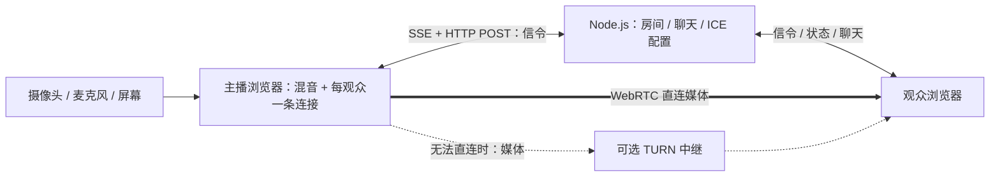

<div align="center">

# LUMA Live

**浏览器互连的轻量直播间：打开开播台，把观众页分享给朋友。**

无需 OBS、RTMP 或转码服务 · Node.js 服务端零第三方运行时依赖


[能做什么](#能做什么) · [快速开始](#快速开始) · [界面](#界面) · [工作原理](#工作原理) · [配置项](#配置项) · [验证与限制](#验证与限制)

</div>

## 能做什么

- **浏览器开播**：摄像头、麦克风、屏幕共享，以及 WebAudio 混音。
- **链接观看**：观众无需安装客户端，浏览器播放并实时聊天。
- **帧率优先的自适应画质**：目标 30 fps，根据链路与编码负载逐观众调节分辨率和 2.5 / 1.2 / 0.6 Mbps 码率上限。
- **轻量信令服务**：SSE + HTTP POST，维护房间、聊天与断线宽限状态。
- **单主播保护**：同一口令只允许一个开播台在线，被顶替的页面会明确提示并停止推流，不会互相抢回。
- **可选 TURN**：下发临时中继凭证，识别中继链路并限制码率。

> **适合小范围分享，不是大规模直播平台。** 每位观众都从主播接收一份媒体流；可承载人数取决于主播上行、设备、网络及运行环境，没有统一的「150 人上限」。延迟和连通性也不作固定保证。

## 快速开始

**只有运行服务的机器需要准备环境；主播和观众使用浏览器。** 本地启动不会自动获得公网地址，`localhost` 也不能直接分享给别人。

### Windows：下载、解压、双击

1. 在仓库顶部选择 **Code → Download ZIP**。
2. 完整解压到一个普通文件夹，例如 `C:\luma-live`，确认其中有 `server.js` 和 `start.bat`。不要在压缩包内运行。
3. 双击 **`start.bat`**。缺少 Node.js 时，脚本会打开下载页；安装 LTS 版本后重新运行脚本。
4. 浏览器自动打开 `http://localhost:3000/studio`，授权摄像头和麦克风，再开始直播。
5. 同一局域网的观众打开 `http://<你的内网IP>:3000/`。

保持命令窗口和主播页面开启；关闭窗口会停止服务。已有 Node.js ≥ 18 时，也可以在项目目录执行 `node server.js`。

### macOS / Linux

```bash
# 先安装 Node.js ≥ 18
git clone https://github.com/ko2en/luma-live.git
cd luma-live
bash start.sh
```

启动后，开播台为 `http://localhost:3000/studio`，观众页为 `http://localhost:3000/`。

### Docker

```bash
docker build -t luma-live .
docker run --rm -p 3000:3000 -e STREAM_KEY=你的口令 luma-live
```

### 几点常识

- **开播端必须是 `localhost` 或 HTTPS**，否则浏览器不允许采集摄像头和麦克风。
- **跨网络分享需要公网地址**：网页能打开不等于媒体能连通，NAT 两侧可能仍需中继。
- **设一个开播口令**。不设 `STREAM_KEY` 时，任何能访问开播接口的人都能开播。

## 界面

### 开播控制台


### 观众页

桌面布局包含播放器与聊天区，窄屏切换为单列。


## 工作原理



### 关键实现

- **SSE 信令**：`GET /api/events` 接收事件，`POST /api/signal` 投递信令。连接池共用心跳，状态广播采用合并窗口。
- **WebAudio 混音**：麦克风和共享音频经各自 gain 节点混入一条 program 音轨；可调音量并切换共享源。
- **断线宽限**：主播信令连接短暂断开后，默认等待 10 秒再结束房间；这不保证页面刷新后原媒体连接仍能续用。
- **逐观众帧率优先**：采集和发送目标均为 30 fps；按网络档位调整最长边到 1280 / 960 / 640（16:9 时约 720p / 540p / 360p，不放大小源）。只改该观众的发送参数，不修改共享采集轨。
- **单主播保护**：新开播台顶替旧会话；旧页面收到 `host-taken` 后断开 peer、释放摄像头麦克风并停止自动重连，需手动确认才能抢回。
- **临时 TURN 凭证**：共享密钥仅留在服务端，客户端收到限时凭证；链路统计用于中继识别。

> **30 fps 是目标，不是最低帧率保证。** 摄像头低光、设备过载、带宽不足或浏览器限制都可能导致低于 30 fps。

### 与 Owncast 的定位区别

项目灵感来自 [Owncast](https://github.com/owncast/owncast)，但媒体路径不同。以下仅说明技术路线，不作第三方版本功能或性能承诺。

| | LUMA Live | Owncast 路线 |
|---|---|---|
| 开播入口 | 浏览器采集 | 通过推流工具向服务器推流 |
| 媒体分发 | 主播逐观众直连，可选 TURN | 服务器处理并分发媒体 |
| 主要容量约束 | 主播上行、设备、连接与中继带宽 | 服务端处理与分发资源 |
| 本项目边界 | 小范围实时观看，不支持录制回看 | 需要服务端直播分发时可评估的方案 |

## 配置项

全部通过环境变量控制，均有默认值；只有 `STREAM_KEY` 在公网使用时必须设置。

| 变量 | 默认 | 作用 |
|---|---|---|
| `PORT` | `3000` | 应用监听端口 |
| `STREAM_KEY` | 空（不鉴权） | 开播口令 |
| `HOST_GRACE_MS` | `10000` | 主播信令断线宽限期（毫秒）；设 `0` 立即结束 |
| `CHAT_MIN_INTERVAL` | `350` | 同一连接聊天的最小间隔（毫秒） |
| `AUTH_MAX_FAILS` | `5` | 同一来源触发锁定的连续失败次数 |
| `AUTH_LOCK_MS` | `60000` | 认证锁定时长（毫秒） |
| `TRUST_PROXY` | 未设 | 设 `1` 时读取 `X-Forwarded-For` 最后一项作为来源 IP |
| `TURN_LINES` | 空 | TURN 线路清单：`id\|host\|port\|secret\|标题`，多条用逗号分隔；secret 留空为匿名中继 |
| `TURN_DEFAULT` | 第一条线路 | 默认线路 id；不设就用 `TURN_LINES` 里的第一条 |

**只有部署在可信反向代理后面才启用 `TRUST_PROXY=1`**：服务端信任头中最后一个地址，须阻止客户端绕过代理直连，否则来源 IP 可被伪造。

### 线路怎么选

`TURN_LINES` 里的每一条都是一个独立入口，页面会把它渲染成下拉：

```
TURN_LINES="sh|turn.example.com|3478|secreta|上海,hk|backup.example.com|3478|secretb|香港"
TURN_DEFAULT=sh
```

- **P2P 直连**永远排在第一项，它只下发 STUN、不给任何 TURN。选它之后能不能看，全看两边能不能打洞；打不通就一直停在「连接中」，需要人自己换线 —— 这是刻意的，不做静默回退。
- 其余各项只下发自己那一条线路的 `iceServers`，其它线路完全不参与协商，所以不会出现「本地的线路明明可用，却因为远端先分配而绕一圈」。
- 只有观众能选线路（下拉在播放器右上角），主播端没有下拉，但**不再固定用 `TURN_DEFAULT`**：
  服务端会把每条线路的现签 ICE 配置一起下发给主播，主播按每个观众当前选的线路逐路建连；
  观众切换线路时服务端发 `viewer-line`，主播只重建那一路。这样两端候选集始终一致，
  P2P 观众不会撞上主播的中继专用候选。`TURN_DEFAULT` 只决定观众首次进入时的默认线路。
- 选了 TURN 线路会强制 `iceTransportPolicy: relay`，只用中继候选：浏览器不会再偷偷走直连，
  所以状态标签会如实显示 `TURN中继·上海`。选 P2P 则是纯直连，各节点只作为 STUN 帮打洞。
- 选择记在 `localStorage`，只影响这台设备；也可以直接在地址上加 `?turn=<线路 id>`（`?turn=p2p` 就是纯直连）。
- 服务端收到不认识的线路 id 时退回默认线路，不会因此连不上。

主播状态栏只统计已经连通的连接，例如 `P2P 1路 / TURN 2路（上海 2）`；观众页连接标签显示 `P2P直连` 或 `TURN中继·上海`。换线路要重建媒体连接，切换瞬间画面会短暂重连一次。

## 验证与限制

### 本地验证

```bash
node scripts/test-api.js
npm run test:video
npm run test:single-host
```

API 回归会启动临时服务，覆盖认证、限速、信令、聊天、断线宽限、单主播保护与 ICE 配置等行为。浏览器脚本还包括 `scripts/test-studio-key.js`（开播口令流程）、`scripts/test-e2e.js`（开播、观看与刷新重连）、`scripts/test-relay.js`（**模拟** relay 候选，检查中继识别及码率限制）。

测试通过只说明对应场景通过，不等于完成跨浏览器、跨网络或生产容量验证。

### 已知边界

| 限制 | 影响与处理方向 |
|---|---|
| 主播逐观众发送媒体 | 总上行约为各路实际码率之和；需在目标设备与网络实测 |
| NAT、防火墙或网络策略阻止直连 | 可配置 TURN 并实测；TURN 也不保证绕过所有网络限制 |
| 中继占用独立服务器带宽 | 识别后限制码率，但实际流量含协议、音频和重传开销 |
| 主播设备可能成为瓶颈 | 并发连接、编码、采集及页面渲染均有开销，不能只看服务端 CPU |
| 状态仅在内存 | 重启丢失房间与连接状态，需主播重新建立直播 |
| 仍有安全改进项 | SSE query 口令、共享设备本地存储及公网防护需关注 |

大规模观看建议评估 SFU（如 mediasoup / LiveKit）或服务端媒体分发架构，而不是仅提升信令服务配置。

## 目录结构

```text
server.js              静态服务、SSE、信令、聊天、房间状态与 ICE 下发
public/
  index.html           观众页
  studio.html          开播控制台
  viewer.js            播放、信令、聊天与链路统计
  studio.js            采集、混音、逐观众建连与码率分档
  styles.css           界面样式
scripts/               API 与浏览器回归测试
start.bat              Windows 启动入口
start.sh               macOS / Linux 启动入口
Dockerfile             容器构建配置
docs/                  README 截图
```

## 路线图

- [x] 开播口令与认证失败限速
- [x] 信令方向校验与连接身份检查
- [x] 主播信令断线宽限期
- [x] 按观众链路统计调节码率
- [x] TURN 凭证下发与中继识别逻辑
- [x] 帧率优先与逐观众自适应分辨率（30 fps 目标）
- [x] 单主播保护与接管流程
- [ ] 完成真实公网 TURN relay 链路验证
- [ ] SSE 用短期 token 取代 query 中的口令
- [ ] 录像与回看
- [ ] 可选 SFU 模式

## License

[MIT](LICENSE)
