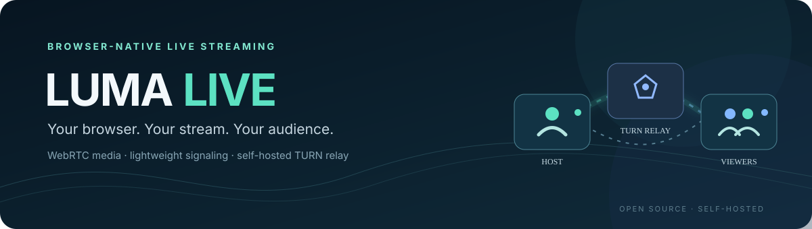
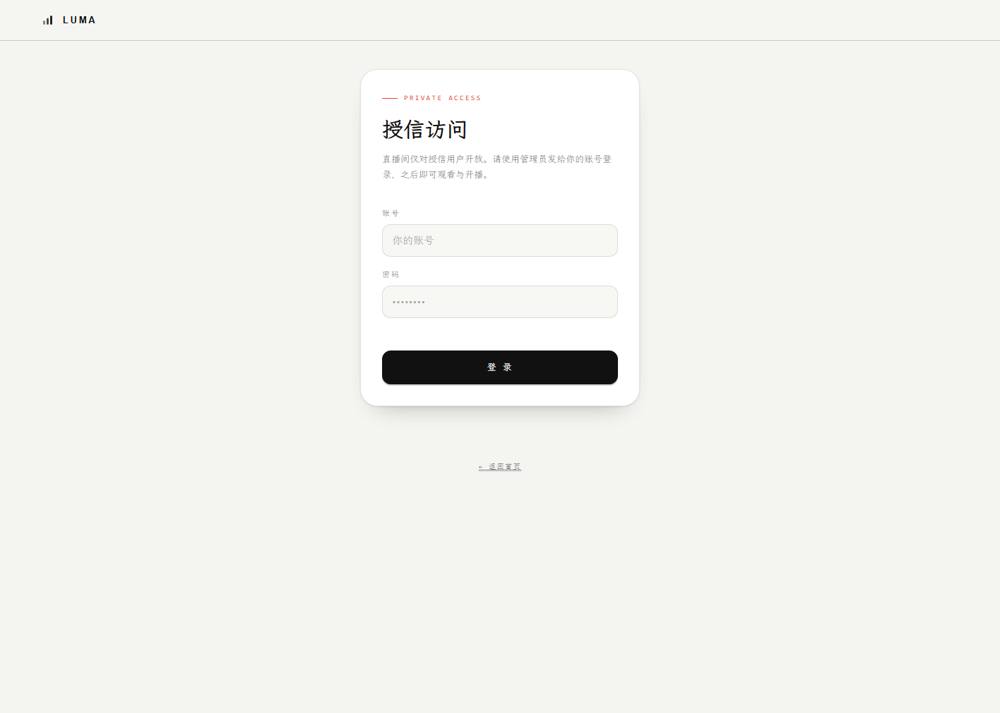
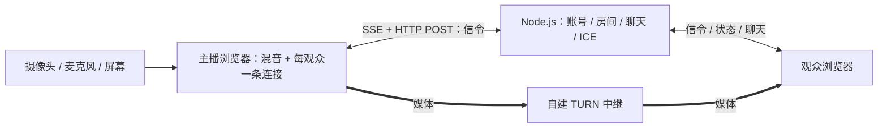

<div align="center">



# LUMA Live

### Your browser. Your stream. Your audience.

**浏览器原生的轻量实时直播**

从摄像头到观众，只需一个浏览器和一个分享链接。
无需 OBS、RTMP 推流器或媒体转码服务器。

<p>
  <a href="https://github.com/ko2en/luma-live/blob/main/LICENSE"></a>
  
  
  
  <a href="https://github.com/ko2en/luma-live/actions/workflows/ci.yml"></a>
</p>

[快速开始](#快速开始) · [部署方式](#部署方式) · [部署 TURN](#部署-turn) · [产品能力](#产品能力) · [架构](#架构) · [配置参考](#配置参考) · [更新日志](CHANGELOG.md)

</div>

<br>

> **产品定位**　LUMA Live 为小范围、低门槛实时分享而设计。当前采用「主播逐观众」的星型拓扑，媒体全部经自建 TURN 中继转发，**不是面向大规模观众的直播 CDN / SFU**。实际并发取决于主播上行、终端编码能力、网络与 TURN 带宽。

## 为什么是 LUMA Live

把直播链路尽量留在浏览器里：主播负责采集和发送，观众直接观看；轻量服务端只做登录、房间状态、聊天与 WebRTC 信令。

| **01 · 直接开播** | **02 · 浏览器观看** | **03 · 自托管** |
|:---|:---|:---|
| 摄像头、麦克风、屏幕共享与 WebAudio 混音 | 分享网页即可观看和实时聊天 | 单 Node.js 进程；无第三方运行时依赖 |
| 不需要 OBS 或 RTMP 推流器 | 无需安装专用客户端 | TURN 凭证由服务端按需签发 |

## 产品能力

<details open>
<summary><strong>直播工作流</strong></summary>

- 浏览器采集摄像头、麦克风、屏幕共享音视频，并通过 WebAudio 混音。
- 主播可创建直播，观众通过浏览器观看、聊天。
- 固定发送档位为 1280×720、60 fps，视频码率上限 2.8 Mbps；这些是目标参数，不是性能保证 ——
  摄像头不支持 60fps、或上行吃紧时会自动降到设备/网络能给的水平。
- 单主播保护、会话接管提示，以及主播信令短暂断线后的 10 秒重连宽限。
- 摄像头热切换：切换设备时替换发送轨，不重建连接，观众端不中断。
- 网页内连接诊断：不用先开播，逐项检查凭证、线路、中继候选、UDP/TCP 与握手耗时。

</details>

<details>
<summary><strong>连接与安全边界</strong></summary>

- SSE + HTTP POST 承载房间事件与 WebRTC 信令；媒体不经过 Node.js 应用服务器。
- 媒体强制经配置的 TURN 中继，不静默退回浏览器直连。
- 支持账号登录、HttpOnly cookie、登录失败限速、自助改密与头像。
- TURN 使用 coturn REST 方式签发限时凭证，共享密钥保留在服务端。
- 开播口令不进 URL：先用 `POST /api/sse-ticket` 换 60 秒一次性票据，再拼进 SSE query。
- CSP / Permissions-Policy / COOP / CORP 等安全响应头，写接口校验 Origin/Referer。

</details>

## 快速开始

### Windows

1. 从 GitHub 选择 **Code → Download ZIP** 并完整解压（不要在压缩包内运行）。
2. 确认目录中包含 `server.js` 和 `start.bat`，双击 `start.bat`。
3. 如果没有 Node.js，按提示安装 **Node.js LTS（≥18）** 后重新运行。
4. 打开 <http://localhost:3000/login> 登录，再进入开播台并授权摄像头、麦克风。
5. 局域网观众可访问 `http://<运行服务的内网IP>:3000/`。

`AUTH_USERS` 只在首次启动时作为种子写入 `data/users.json`，之后账号以文件为准 ——
改环境变量不会覆盖已有账号。真要上公网别走这套手动流程，直接用下面的[部署方式](#部署方式)。

也可以在项目目录执行：

```powershell
node server.js
```

### macOS / Linux

```bash
git clone https://github.com/ko2en/luma-live.git
cd luma-live
AUTH_USERS="主播:请替换为强密码" bash start.sh
```

启动后：

- 登录页：<http://localhost:3000/login>
- 开播台：<http://localhost:3000/studio>
- 观众页：<http://localhost:3000/>

### Docker

```bash
docker build -t luma-live .
docker run --rm -p 3000:3000 \
  -e AUTH_USERS="主播:请替换为强密码" \
  -e TURN_LINES="hk|turn.example.com|23478|secret|香港" \
  -v luma-data:/app/data \
  luma-live
```

## 部署方式

一键脚本按「机器怎么分」给了三种模式（Ubuntu / Debian）：

```bash
# 1) 一台机器同时跑 LUMA 和 TURN
sudo bash scripts/deploy.sh all-in-one <公网IP或域名>

# 2) 两台机器：TURN 机装中继并打印 TURN_LINES
sudo bash scripts/deploy.sh turn <公网IP或域名>
#    应用机拿到上面那行，装 LUMA
sudo bash scripts/deploy.sh app "main|turn.example.com|3478|<secret>|主线路"

# 3) 任意机器自检（不需要 root）
bash scripts/deploy.sh status
```

`all-in-one` 与 `turn` 内部会调用 `scripts/setup-turn.sh`，不会重复装 coturn。
`app` 模式只装依赖、同步代码、写 `/etc/luma-live.env`、注册 systemd 服务，不碰 TURN。
三种模式都是幂等的：重复执行只会覆盖代码与配置，不会重置已有账号库。

`app` 模式在首次启动、`data/users.json` 生成之后，会把 `AUTH_USERS` 从
`/etc/luma-live.env` 里删掉 —— 账号从此以文件为唯一真相，环境文件不再留种子。

## 部署 TURN

> **需要跨网络观看？** 在公网 Ubuntu / Debian 服务器运行下面的命令，脚本会安装 coturn、生成随机共享密钥并准备 LUMA Live 配置。

```bash
git clone https://github.com/ko2en/luma-live.git
cd luma-live
sudo bash scripts/setup-turn.sh turn.example.com
```

没有域名时，可将 `turn.example.com` 替换为服务器公网 IP。执行前先在云厂商控制台创建 Ubuntu / Debian 服务器，并确保自己有 SSH 和 sudo 权限。

```bash
# 如果 LUMA Live 与 TURN 在同一台服务器
set -a
source /etc/luma-live/turn.env
set +a
node server.js
```

如果 LUMA Live 运行在另一台机器，将 `/etc/luma-live/turn.env` 安全传到该机器后再 `source`。该文件包含 TURN 密钥，传输时应使用 SSH/SCP 等安全方式，限制文件读取权限，并且**绝不要提交到 Git 或公开粘贴**。

> [!WARNING]
> 脚本只自动配置服务器本机启用状态下的 `ufw`。云厂商安全组仍需手动放行 TCP/UDP `3478`、TCP/UDP `5349` 和 UDP `49152-65535`。脚本面向 Ubuntu / Debian + systemd，不会自动购买云服务器、配置域名 / TLS 证书或修改云安全组。正式公网部署请先验证防火墙与 TURN 连通性。

### 部署前必读

- 摄像头和麦克风采集要求开播端运行在 **`localhost` 或 HTTPS**。
- 跨网络观看需要公网可达的 TURN 服务；能打开网页不代表媒体链路一定连通。
- 公网部署务必配置 `AUTH_USERS`，或在无账号鉴权的旧部署中配置 `STREAM_KEY`。两者都没有时，鉴权会关闭。
- 请使用强密码，并将 `AUTH_SECRET`、TURN secret 等敏感值放在环境变量或密钥管理系统中。
- 关闭 Node.js 进程或主播页面可能导致直播结束；主播信令短暂断线默认有 10 秒重连宽限。

## 界面预览

| 登录页 | 开播控制台 | 观众页 |
| --- | --- | --- |
|  |  |  |

窄屏观众页会从播放器 + 聊天双栏切换为单列布局；开播台的摄像头与麦克风来源都能在开播过程中切换。

## 架构



### 关键设计

- **信令**：`GET /api/events` 接收事件，`POST /api/signal` 投递信令；连接池共用心跳，状态广播采用合并窗口。
- **媒体**：主播为每位观众建立独立 WebRTC 连接；服务端只负责信令和配置，不处理媒体转码。
- **强制中继**：浏览器使用 `iceTransportPolicy: relay`，`iceServers` 只下发配置的 TURN（UDP + TCP）。中继不可用时直接失败。
- **临时凭证**：coturn REST 凭证由服务端现签，客户端只拿到限时凭证。
- **输入校验**：`users.json` 按不可信输入处理 —— 校验版本、单条记录结构、账号名合法字符与数量上限，坏记录跳过并告警；`scrypt` 参数限定在合理区间（N 必须是 2 的幂、内存上限 256MB），避免被放大的参数拖死进程。
- **账号安全**：密码用 scrypt（随机盐）存储，旧的 `sha256:` 或明文记录在成功登录后自动升级；登录 cookie 为 HttpOnly + SameSite=Strict；失败次数按来源 IP 限制，连续失败达到阈值后暂时锁定。
- **口令不进 URL**：开播端先用 `POST /api/sse-ticket` 把口令换成 60 秒一次性票据，再拼进 SSE 的 query，口令只出现在请求体里，不会落到反代访问日志。
- **重连与接管**：主播信令断开后进入宽限期；新开播台接管时，旧页面收到 `host-taken` 后停止推流和自动重连。
- **连接诊断**：开播台可以就地跑一次 relay-only 的候选收集（`GET /api/ice` 取临时凭证），把「凭证 / 线路 / 中继候选 / UDP / TCP / 握手耗时」逐项列出来，不用先开播就能判断 TURN 通不通。

## 设计取舍

项目灵感来自 [Owncast](https://github.com/owncast/owncast)，但两者媒体路径不同：

| | LUMA Live | Owncast 路线 |
| --- | --- | --- |
| 开播入口 | 浏览器采集 | 推流工具向服务器推流 |
| 媒体分发 | 主播逐观众经 TURN 中继 | 服务端处理并分发媒体 |
| 主要容量约束 | 主播上行、设备、连接数与中继带宽 | 服务端处理与分发资源 |
| 适用场景 | 小范围、低部署成本的实时分享 | 需要服务端媒体分发的直播场景 |

## 配置参考

全部通过环境变量控制。公网部署至少设置 `AUTH_USERS`（或兼容旧部署的 `STREAM_KEY`）和 `TURN_LINES`。

| 变量 | 默认值 | 作用 |
| --- | --- | --- |
| `PORT` | `3000` | 应用监听端口 |
| `AUTH_USERS` | 空 | 初始账号：`用户名:密码[,用户名:密码...]`，首次启动写入 `data/users.json`；密码可写明文或 `node scripts/hash-pass.js 密码` 生成的 scrypt 摘要 |
| `AUTH_SECRET` | 空 | 会话签名密钥；不设置时重启后需重新登录 |
| `AUTH_TTL_SEC` | `2592000` | 登录有效期（秒，最小 1 小时） |
| `AUTH_MAX_FAILS` | `5` | 连续登录失败次数阈值 |
| `AUTH_LOCK_MS` | `60000` | 登录锁定时长（毫秒） |
| `COOKIE_SECURE` | 未设置 | HTTPS 部署时设为 `1`，cookie 仅走加密连接 |
| `STREAM_KEY` | 空 | 未配置账号时的兼容开播口令 |
| `LUMA_DATA_DIR` | `./data` | 账号库与头像目录 |
| `HOST_GRACE_MS` | `10000` | 主播信令断线宽限期（毫秒） |
| `CHAT_MIN_INTERVAL` | `350` | 单连接聊天最小间隔（毫秒） |
| `TRUST_PROXY` | 未设置 | 可信反向代理后设为 `1`，读取 `X-Forwarded-For` |
| `TURN_LINES` | 空 | `id\|host\|port\|secret\|标题`，多条逗号分隔；当前只使用第一条 |
| `TURN_DEFAULT` | 第一条线路 | 指定生效的线路 id（找不到就退回第一条）；页面始终只用这一条，不提供切换 |

示例：

```bash
TURN_LINES="hk|turn.example.com|23478|secret|香港"
```

> `TRUST_PROXY=1` 只能用于可信反向代理之后。否则客户端可能伪造来源 IP，影响登录限速与审计。

## 测试

```bash
npm test              # API 回归：认证、限速、信令、聊天、重连与 ICE
npm run test:video    # 发送参数与画质
npm run test:relay    # relay 候选与中继识别
npm run test:e2e      # 开播、观看、刷新重连
npm run test:studio   # 开播口令流程
npm run doctor        # 部署自检：Node 版本、数据目录、账号、TURN、端口占用
node scripts/hash-pass.js '密码'   # 生成可写进 AUTH_USERS 的 scrypt 摘要
```

以上命令由 CI（`.github/workflows/ci.yml`）在每次推送时执行，另外还会跑 JS / shell 语法检查、
脚本可执行位检查与 `npm run doctor`：

```bash
for f in server.js src/*.js scripts/*.js; do node --check "$f"; done
for f in scripts/*.sh start.sh; do bash -n "$f"; done
```

> 测试通过仅表示相应自动化场景通过，不等价于跨浏览器、跨网络或生产容量认证。

部署后可以先跑一次 `npm run doctor` 再开播；TURN 那边有对应的只读自检：

```bash
bash scripts/setup-turn.sh --check
```

反代与守护进程的模板放在 `deploy/`：`Caddyfile.example`、`nginx.conf.example`、`luma-live.service`。
服务端提供 `/healthz`（进程存活）和 `/readyz`（数据目录可写、账号与 TURN 配置），两者都不需要登录，可以直接挂给探针。

## 运行边界

| 当前设计 | 实际影响 |
|:---|:---|
| 主播为每位观众分别发送媒体 | 上行带宽与浏览器编码能力随观众数增加 |
| 强制走 TURN 中继 | 需承担独立中继带宽；网络策略也可能阻断中继 |
| 房间状态保存在内存 | 服务重启后需要重新建立直播 |
| 固定发送档位（720p / 60fps / 2.8Mbps） | 没有逐观众自适应码率；60fps 的带宽开销约为 30fps 的两倍 |
| 暂无媒体录制与 SFU | 不提供回放，不适合大规模分发 |

若目标是大规模观看，应评估 mediasoup、LiveKit 等 SFU 或服务端媒体分发方案，而非只提高信令服务配置。公网运行前也应评估 SSE 凭证、共享设备本地存储和反向代理防护。

## 目录结构

```text
server.js               HTTP 装配：路由、登录态、SSE 接入、房间 API（约 900 行）
src/
  config.js             所有环境变量的唯一入口（默认值、兼容老变量、路径解析）
  http.js               JSON 响应、请求体、安全响应头、跨站校验、静态文件
  live.js               运行态：在线连接、SSE 广播、聊天记录、断线宽限
  users.js              账号库：users.json 原子写、头像文件校验
  password.js           scrypt 摘要与老格式（sha256/明文）透明升级
  turn.js               TURN 线路与 REST 凭证现签
  util.js               定时安全比较
public/                 登录页、观众页、开播台与前端逻辑
scripts/                回归测试、deploy.sh（一键部署）、setup-turn.sh、hash-pass.js
deploy/                 Caddyfile、nginx.conf、systemd 模板
.github/workflows/      CI：语法检查、API 回归、部署自检
CHANGELOG.md            版本变更与升级注意事项
start.bat / start.sh    Windows / macOS / Linux 启动入口
Dockerfile              容器构建配置
docs/                   README 截图与横幅
data/                   运行时生成的账号库与头像（不入库）
```

## 路线图

- [x] 账号登录、失败限速与自助改密
- [x] 信令方向校验与连接身份检查
- [x] 主播信令断线宽限期
- [x] 单主播保护与接管流程
- [x] TURN 凭证下发与中继识别
- [x] 强制中继的固定发送参数
- [x] 公网 TURN 中继链路实测
- [x] SSE 使用短期票据取代 query 中的凭证
- [x] 密码升级到 scrypt + 旧格式透明迁移
- [x] 网页内 TURN / WebRTC 连接诊断
- [x] 摄像头热切换（replaceTrack，不重建连接）
- [x] Ubuntu / Debian 一键部署：同机 / 拆分两种拓扑
- [x] 健康检查、部署自检与 CI
- [ ] 设备管理面板（音频输出、断线自动恢复）
- [ ] 录像与回看
- [ ] 可选 SFU 模式
- [ ] 逐观众自适应码率（暂不计划：固定档位是主动取舍，反复调档容易带来画面抖动）

## 贡献与反馈

欢迎通过 Issue 反馈问题或提出改进建议。提交前请附上 Node.js 版本、部署方式、浏览器、网络环境和可复现步骤；请勿在 Issue 中公开账号、密码、TURN secret 或 cookie。

## License

本项目基于 [MIT License](LICENSE) 发布。
