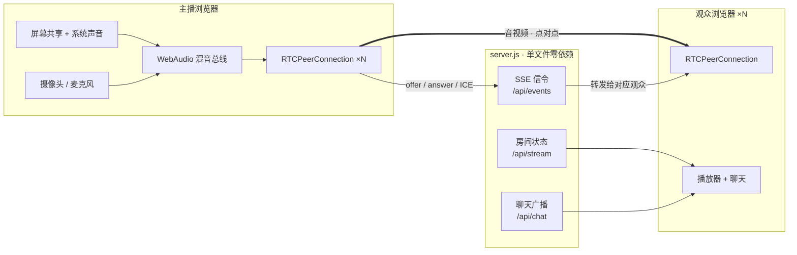
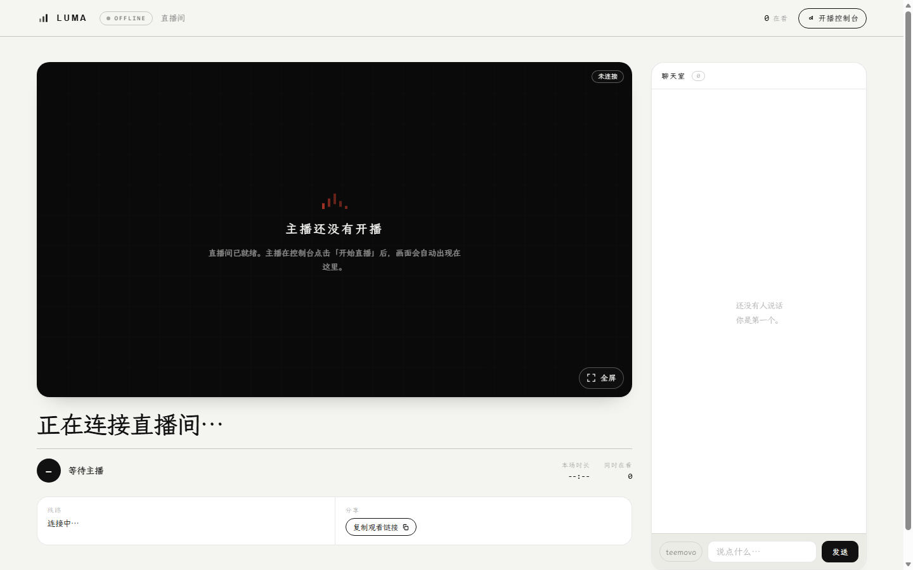

<div align="center">

# LUMA Live

**浏览器互连的直播间 · 打开一个网页就能开播**

不需要 OBS · 不需要 RTMP · 不需要转码服务器

<br>


<br>

[30 秒上手](#30-秒上手) · [工作原理](#工作原理) · [安装与部署](#安装与部署) · [已知限制](#已知限制)

</div>

## 30 秒上手

三种方式，挑一种。**观众不需要做任何事**——你把地址发给他就行。

### ① Windows：双击就开播

1. 点仓库右上角绿色 **Code → Download ZIP**
2. 解压到 `C:\luma-live`（不要在压缩包里直接双击）
3. 双击 **`start.bat`**

脚本会自动检查 Node.js——没装就帮你打开下载页，装好了就启动服务并自动打开开播台。仓库已经带了这个文件，不用写任何命令。

### ② macOS / Linux / Docker：一条命令

```bash
# 原生运行（需要 Node 18+）
git clone https://github.com/ko2en/luma-live.git && cd luma-live && ./start.sh

# 或者 Docker（连 Node 都不用装）
git clone https://github.com/ko2en/luma-live.git && cd luma-live && docker compose up -d
```

Windows 上装了 Docker 也一样适用，`docker compose up -d` 然后访问 `http://localhost:3000`。

### ③ 云端一键部署：点一下就有公网地址

[](https://render.com/deploy?repo=https://github.com/ko2en/luma-live)

点上面的按钮，用 GitHub 账号登录，确认后几分钟内给你一个 `https://xxx.onrender.com` 地址。**HTTPS 自动配好**，所以开播端点开就能用摄像头，不用自己折腾证书。免费额度足够个人直播（闲置一段时间实例会休眠，访问一下会自动唤醒）。

其他支持 Node 的平台（Railway / Koyeb / Zeabur / Fly.io）同理：仓库根目录有 `Dockerfile` 和 `render.yaml`，构建命令留空、启动命令填 `node server.js` 即可。

> 无论是哪种方式，开播都要用 `http://localhost:3000/studio`（或平台给的 https 地址）。用 `IP:3000` 打开会拿不到摄像头——这是浏览器强制的安全策略，详见[安装与部署](#安装与部署)。

## 界面


## 这是什么

主播打开 `/studio`，点一下「开始直播」，摄像头画面立刻进直播间；观众打开链接就能看，还能实时聊天。

**音视频不经过服务器**——主播和每个观众之间直接建立 WebRTC 点对点连接。服务器只做三件事：转发信令、维护房间状态、广播聊天消息。所以一台 1 核 512MB 的小机器就能撑起一整场直播。

```
主播浏览器 ──────── WebRTC 音视频直连 ────────▶ 观众浏览器
     │                                              ▲
     │  信令 / 状态 / 聊天（KB 级，走服务器）          │
     └──────────────▶  server.js  ──────────────────┘
```

## 它适合你吗

先把丑话说在前面，省得你装完才发现不对：

| 你的场景 | 合不合适 |
|---|---|
| 和同事、朋友开个小直播，10 人以内 | ✅ **最合适**，一个文件夹搞定 |
| 想零成本、当天就能用 | ✅ 零依赖、零配置、零费用 |
| 内网 / 离线环境直播（没有公网） | ✅ 纯 P2P，只要两边网络能通 |
| 需要一个「低延迟监看」画面（导播、远程看片场） | ✅ 延迟通常 1 秒内 |
| 想替代 Zoom / 腾讯会议开会 | ⚠️ 没有多人宫格、没有会控、没有录制 |
| 要几百上千人同时看 | ❌ 换 SFU（mediasoup / LiveKit） |
| 要录播回看、要手机原生播放器能看 | ❌ 不支持 |

一句话：**它是「房间」，不是「平台」。** 如果你的需求是"点开就能播、发给几个人看、延迟要低、别花钱"，它就是为你做的。

## 和 Owncast 有什么区别

项目灵感来自 [Owncast](https://github.com/owncast/owncast)，但技术路线完全不同——它是一条"推流管线"，这是一条"电话总机"。

|  | Owncast | LUMA Live |
|---|---|---|
| 开播方式 | OBS 推 RTMP 到服务器 | **浏览器点按钮** |
| 媒体路径 | 服务器收流 → ffmpeg 转码 → HLS 分发 | **浏览器 ↔ 浏览器直连** |
| 延迟 | 10–30 秒（HLS） | **< 1 秒** |
| 服务器带宽 | 每个观众 1–3 Mbps | **接近 0** |
| 观众规模 | 看 CDN，轻松上千 | 约 150（受并发长连接限制） |
| 回看 / 录像 | 支持 | 不支持 |
| 播放端 | 任何播放器 / 手机 | 只能是浏览器 |

一句话：**Owncast 是能运营的直播平台，LUMA Live 是打开就能用的房间。**

## 工作原理



## 三个值得一看的实现

**1. 用 SSE 而不是 WebSocket 做信令**
`GET /api/events` 是普通 HTTP 长连接，穿反向代理、企业网关、CDN 都不需要额外配置；断开后浏览器自动重连。配合 `POST /api/signal` 做单向投递，实现起来比 WebSocket 简单一个数量级。全服务端共用一个 20 秒心跳定时器，而不是每个连接一个。

**2. WebAudio 混音总线，把两路音频合成一条**
麦克风和屏幕共享通常各自带一条音轨。直接二选一会丢掉系统声音（播放视频时观众听不到），推两条轨又要处理协商。做法是在前端建一条混音总线：

```js
micSource → micGain ┐
                    ├→ masterGain → MediaStreamAudioDestination → 单条 program 音轨
screenSource → screenGain ┘
```

静音用 `gain` 渐变而不是 `stop()`，避免重新协商；直播中开停屏幕共享也能无感切换。

**3. 服务端扇出：把 O(N²) 压回 O(N)**
观众成批涌入时，每个新人触发一次全量状态广播，就是 O(N²)。改成 200ms 合并窗口 + 一次 `flush`，同时把广播改成预构造 frame 后直接遍历连接池。2000 个连接建立时间从 **42 秒降到 1.8 秒**，单条消息扇出中位数 **11ms**。

## 安装与部署

先说清楚一件事：**观众什么都不用装**，打开浏览器就能看。整个项目只有一台机器需要准备，就是运行 `server.js` 的那台——它负责信令、房间状态和聊天。音视频是浏览器之间直连的，不经过它。

这台机器有两种选择：

| | 你自己的 Windows 电脑 | 一台云服务器 |
|---|---|---|
| 谁能看 | 同一 Wi-Fi 的人；外网要加个穿透隧道 | 任何人，凭链接 |
| 长期在线 | 关机/休眠就断，页面必须一直开着 | 7×24 常驻 |
| HTTPS | 本机开播可以，对外要额外处理 | 域名 + 自动证书，一次配好 |
| 花费 | 0 | 最低配约 ¥30/月 |
| 适合 | 自己、同事、朋友几个人 | 要发给一批人看 |

### 装到哪里

其实没有「安装」这一步——就是一个文件夹里的文件。不写注册表、不装驱动、不注册系统服务、不连数据库。删掉文件夹就等于卸载干净。

| 系统 | 建议位置 | 不要放 |
|---|---|---|
| Windows | `C:\luma-live` | 桌面、下载、`C:\Program Files`、中文或带空格的路径 |
| Linux | `/opt/luma-live` | `/root`、`/tmp` |

唯一的前置依赖是 **Node.js ≥ 18**。

> 想省事的话，这一节可以整段跳过：Windows 直接双击仓库里的 **`start.bat`**，macOS / Linux 执行 **`./start.sh`**，脚本会自己检查 Node、启动服务、打开浏览器。下面写的是想自己控制每一个步骤（或者要部署到服务器）时的做法。

### 方案 A：装在自己的 Windows 电脑上

1. **装 Node.js** —— 到 [nodejs.org](https://nodejs.org) 下载 LTS 的 `.msi`，一路下一步。装完打开 PowerShell 验证：`node -v`（应显示 v18 以上）
2. **放代码** —— 新建 `C:\luma-live`，把代码放进去：装了 git 就 `git clone https://github.com/ko2en/luma-live.git C:\luma-live`，没装就点仓库右上角 **Code → Download ZIP**，解压到 `C:\luma-live`
3. **启动** —— 双击 `C:\luma-live\start.bat`（它会自己开浏览器），或者在 PowerShell 里手动执行：

```powershell
cd C:\luma-live
node server.js
```

看到 `LUMA Live 已启动` 就成了，然后：

| 你要做的事 | 地址 |
|---|---|
| 开播 | `http://localhost:3000/studio` |
| 同一 Wi-Fi 的观众 | `http://<你的内网IP>:3000`（`ipconfig` 查 IPv4） |
| 不在同一网络的观众 | 见下面「内网穿透」 |

首次启动 Windows 防火墙会弹窗，勾**专用网络**并允许，否则局域网里别人连不进来。

**内网穿透**（不在同一 Wi-Fi 的人要看，又不想买服务器）：装 [cloudflared](https://developers.cloudflare.com/cloudflare-one/connections/connect-networks/downloads/)，在服务启动的同时另开一个窗口执行：

```powershell
cloudflared tunnel --url http://localhost:3000
```

它会打印一个临时的 `https://xxx.trycloudflare.com` 地址，直接发给别人就能看。顺带把 HTTPS 也解决了（下面会讲为什么需要它）。

### 方案 B：装到云服务器

最小配置就够：**1 核 1G**，Ubuntu 22.04 或 Debian 12。因为媒体流不走服务器，带宽只要够加载页面，3–5 Mbps 就行。

```bash
# 1. 装 Node 20
curl -fsSL https://deb.nodesource.com/setup_20.x | sudo -E bash -
sudo apt install -y nodejs git

# 2. 代码放 /opt
sudo mkdir -p /opt/luma-live && sudo chown "$USER":"$USER" /opt/luma-live
git clone https://github.com/ko2en/luma-live.git /opt/luma-live

# 3. 试跑
cd /opt/luma-live && PORT=3000 node server.js
```

试通了再做成常驻服务，新建 `/etc/systemd/system/luma-live.service`：

```ini
[Unit]
Description=LUMA Live
After=network.target

[Service]
WorkingDirectory=/opt/luma-live
Environment=PORT=3000
ExecStart=/usr/bin/node server.js
Restart=always
User=你的用户名

[Install]
WantedBy=multi-user.target
```

```bash
sudo systemctl daemon-reload
sudo systemctl enable --now luma-live
sudo systemctl status luma-live     # 看是否 active (running)
```

**配 HTTPS**：用 Caddy 最省事，证书自动申请续期。`/etc/caddy/Caddyfile`：

```
live.example.com {
    reverse_proxy 127.0.0.1:3000 {
        flush_interval -1
    }
}
```

`flush_interval -1` 这行是关键——不写的话 SSE 会被缓冲，表现是页面能打开、聊天半天不动、开播后观众一直黑屏。

用 Nginx 的话，`location /` 里必须有这三行：

```nginx
proxy_http_version 1.1;
proxy_buffering off;          # 关掉缓冲，SSE 才能实时推送
proxy_read_timeout 3600s;     # 长连接别被默认 60s 掐断
```

最后：安全组/防火墙只放行 **80 和 443**，不要把 3000 端口暴露到公网。

### 五个最容易踩的坑

1. **用 `IP:3000` 打开 `/studio` 拿不到摄像头** —— 采集要求安全上下文（secure context），主播端必须是 `localhost` 或 `https://`。这是浏览器强制的，不是本项目的问题。
2. **反向代理忘了关缓冲** —— 页面正常但聊天不动、观众黑屏，八成是这行漏了。
3. **把 3000 直接暴露公网** —— 既没有 TLS 也没必要，统一经 80/443 转发。
4. **电脑休眠/关盖** —— 服务挂了直播就断。服务端状态全在内存，不落盘，重启即清空。
5. **以为人多了要加 CPU** —— 真正的瓶颈是主播的上行带宽和并发连接数，不是 CPU；1 核机器跑信令毫无压力。

> 补充：摄像头/麦克风采集要求**安全上下文**，`localhost` 或 HTTPS 都算；屏幕共享的**系统声音**只有 Chrome / Edge 支持，且共享「标签页」时才带音频。


观众打开后看到的是这样——左侧播放器，右侧实时聊天，手机浏览器自动切成单列：



## 目录结构

```
server.js            静态文件 + SSE 信令 + 聊天 + 房间状态（404 行）
public/
  index.html         观众页
  studio.html        开播控制台
  viewer.js          播放器 + 信令客户端 + 聊天
  studio.js          采集、混音、逐观众建连、设备热切换
  styles.css         全部样式
docs/                README 用的截图
```

## 已知限制

这套架构用「省带宽」换掉了「兜底能力」，边界很清楚：

| 限制 | 原因 | 缓解方式 |
|---|---|---|
| 约 150 人同时在线 | 托管层单实例并发长连接配额 | 换更大的实例 / 前置 CDN |
| 对称 NAT 下黑屏 | 没有 TURN 中继，P2P 打不通就无解 | 加 coturn |
| 主播上行 = 观众数 × 码率 | 每个观众一份独立编码 | 家用宽带约 10 人上限 |
| 无回看、无录制 | 不落盘 | 需要单独做录制链路 |
| 重启丢状态 | 全内存实现 | 主播需保持页面打开 |

要突破人数上限，必须换成 SFU（mediasoup / LiveKit）——由服务器分发而不是主播逐份推。这不是调参能解决的。

## 路线图

- [ ] TURN 中继（解决对称 NAT 黑屏）
- [ ] 码率分档：360p / 540p / 720p 按观众网络自适应
- [ ] 录像与回看（MediaRecorder 落盘）
- [ ] 可选 SFU 模式，突破点对点人数上限

## License

[MIT](LICENSE)
