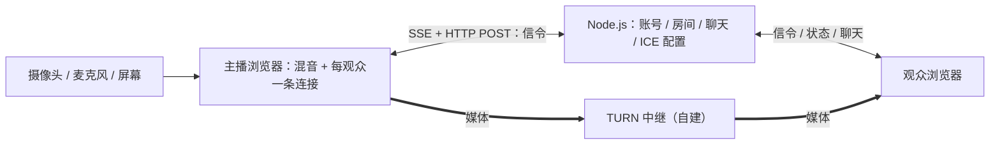

<div align="center">

# LUMA Live

**浏览器开播的轻量直播间：打开开播台，把观众页分享给朋友。**

无需 OBS、RTMP 或转码服务 · Node.js 服务端零第三方运行时依赖


[能做什么](#能做什么) · [快速开始](#快速开始) · [界面](#界面) · [工作原理](#工作原理) · [配置项](#配置项) · [验证与限制](#验证与限制)

</div>

## 能做什么

- **浏览器开播**：摄像头、麦克风、屏幕共享，以及 WebAudio 混音。
- **链接观看**：观众无需安装客户端，浏览器播放并实时聊天。
- **固定发送参数**：统一 1280×720 / 30 fps / 1.2 Mbps 上限，每位观众一条独立的 WebRTC 连接。
- **轻量信令服务**：SSE + HTTP POST，维护房间、聊天与断线宽限状态。
- **账号登录**：`AUTH_USERS` 作为首次种子写入 `data/users.json`，之后用户可在网页里改自己的账号、密码和头像；未登录只能看到登录页。
- **单主播保护**：同一账号只允许一处开播，被顶替的页面会明确提示并停止推流，不会互相抢回。
- **TURN 中继**：媒体强制经自建 TURN 服务器转发，浏览器之间不建立直连，也不做回退。

> **适合小范围分享，不是大规模直播平台。** 每位观众都从主播接收一份媒体流；可承载人数取决于主播上行、设备、网络及中继带宽，没有统一的「150 人上限」。延迟和连通性也不作固定保证。

## 快速开始

**只有运行服务的机器需要准备环境；主播和观众使用浏览器。** 本地启动不会自动获得公网地址，`localhost` 也不能直接分享给别人。

### Windows：下载、解压、双击

1. 在仓库顶部选择 **Code → Download ZIP**。
2. 完整解压到一个普通文件夹，例如 `C:\luma-live`，确认其中有 `server.js` 和 `start.bat`。不要在压缩包内运行。
3. 双击 **`start.bat`**。缺少 Node.js 时，脚本会打开下载页；安装 LTS 版本后重新运行脚本。
4. 浏览器打开 `http://localhost:3000/login`，用你设置的账号登录，再进开播台授权摄像头和麦克风。
5. 同一局域网的观众打开 `http://<你的内网IP>:3000/`，用各自的账号登录后观看。

保持命令窗口和主播页面开启；关闭窗口会停止服务。已有 Node.js ≥ 18 时，也可以在项目目录执行 `node server.js`。

### macOS / Linux

```bash
# 先安装 Node.js ≥ 18
git clone https://github.com/ko2en/luma-live.git
cd luma-live
AUTH_USERS="me:换成你的密码" bash start.sh
```

启动后：登录页 `http://localhost:3000/login`，开播台 `/studio`，观众页 `/`。

### Docker

```bash
docker build -t luma-live .
docker run --rm -p 3000:3000 \
  -e AUTH_USERS="me:换成你的密码" \
  -e TURN_LINES="hk|turn.example.com|23478|secret|香港" \
  -v luma-data:/app/data \
  luma-live
```

### 几点常识

- **开播端必须是 `localhost` 或 HTTPS**，否则浏览器不允许采集摄像头和麦克风。
- **跨网络分享需要公网地址与 TURN**：页面能打开不等于媒体能连通，媒体固定经中继服务器转发，所以中继必须部署在公网可达的位置。
- **一定要设置账号**：不设 `AUTH_USERS`（也没有历史 `data/users.json`）时，登录鉴权整体关闭，任何能访问开播接口的人都能开播。此时才回落到 `STREAM_KEY` 口语义，公网部署务必二选一。

## 界面

### 开播控制台


### 观众页

桌面布局包含播放器与聊天区，窄屏切换为单列。


## 工作原理



### 关键实现

- **SSE 信令**：`GET /api/events` 接收事件，`POST /api/signal` 投递信令。连接池共用心跳，状态广播采用合并窗口。
- **账号会话**：`POST /api/login` 校验后下发 `luma_auth` cookie（HttpOnly，默认 30 天）；`AUTH_SECRET` 用于签名，不配则每次重启都要重新登录。失败按来源 IP 计数，连续 5 次锁定 60 秒。
- **WebAudio 混音**：麦克风和共享音频经各自 gain 节点混入一条 program 音轨；可调音量并切换共享源。
- **断线宽限**：主播信令连接短暂断开后默认等 10 秒再结束房间；页面刷新后能在这段时间内重连回来，超时才结束本场。
- **固定发送参数**：所有观众统一 1280×720 / 30 fps / 1200 kbps 上限，只改该观众的发送参数，不动共享采集轨；不按丢包或 RTT 自动升降档。
- **单主播保护**：新开播台顶替旧会话；旧页面收到 `host-taken` 后断开 peer、释放摄像头麦克风并停止自动重连，需手动确认才能抢回。
- **强制中继**：下发的 `iceServers` 里只有配置的那条 TURN（UDP + TCP 各一条 url），并强制 `iceTransportPolicy: relay`；中继不可用就直接失败，不静默换路。
- **临时 TURN 凭证**：coturn REST 方式现签，共享密钥只留在服务端，客户端只拿到限时凭证。

> **30 fps 是目标，不是最低帧率保证。** 摄像头低光、设备过载、中继带宽不足或浏览器限制都可能导致低于 30 fps。

### 与 Owncast 的定位区别

项目灵感来自 [Owncast](https://github.com/owncast/owncast)，但媒体路径不同。以下仅说明技术路线，不作第三方版本功能或性能承诺。

| | LUMA Live | Owncast 路线 |
|---|---|---|
| 开播入口 | 浏览器采集 | 通过推流工具向服务器推流 |
| 媒体分发 | 主播逐观众经 TURN 中继 | 服务器处理并分发媒体 |
| 主要容量约束 | 主播上行、设备、连接数与中继带宽 | 服务端处理与分发资源 |
| 本项目边界 | 小范围实时观看，不支持录制回看 | 需要服务端直播分发时可评估的方案 |

## 配置项

全部通过环境变量控制，均有默认值；公网部署至少要设置 `AUTH_USERS`（或 `STREAM_KEY`）和 `TURN_LINES`。

| 变量 | 默认 | 作用 |
|---|---|---|
| `PORT` | `3000` | 应用监听端口 |
| `AUTH_USERS` | 空 | 初始账号：`用户名:密码[,用户名:密码 ...]`，只在首次启动时写入 `data/users.json` |
| `AUTH_SECRET` | 空 | 会话签名密钥；不设则每次重启后需要重新登录 |
| `AUTH_TTL_SEC` | `2592000` | 登录有效期（秒），最小 1 小时 |
| `AUTH_MAX_FAILS` | `5` | 同一来源连续登录失败多少次后锁定 |
| `AUTH_LOCK_MS` | `60000` | 锁定时长（毫秒） |
| `COOKIE_SECURE` | 未设 | 站点走 HTTPS 时设 `1`，cookie 只走加密连接 |
| `STREAM_KEY` | 空 | 关闭账号鉴权（未配置账号）时的开播口令，兼容旧部署 |
| `LUMA_DATA_DIR` | `./data` | 账号库与头像的存放目录 |
| `HOST_GRACE_MS` | `10000` | 主播信令断线宽限期（毫秒）；设 `0` 立即结束 |
| `CHAT_MIN_INTERVAL` | `350` | 同一连接聊天的最小间隔（毫秒） |
| `TRUST_PROXY` | 未设 | 设 `1` 时读取 `X-Forwarded-For` 最后一项作为来源 IP |
| `TURN_LINES` | 空 | 中继清单：`id\|host\|port\|secret\|标题`，多条用逗号分隔，**只使用第一条**；secret 留空为匿名中继 |
| `TURN_DEFAULT` | 第一条线路 | 保留兼容；实际固定使用 `TURN_LINES` 第一条 |

**只有部署在可信反向代理后面才启用 `TRUST_PROXY=1`**：服务端信任头中最后一个地址，须阻止客户端绕过代理直连源站，否则来源 IP 可被伪造。

### 线路

只有一条中继线路，没有备用节点，页面也没有任何切换入口：

```
TURN_LINES="hk|turn.example.com|23478|secret|香港"
```

- 下发的 `iceServers` 里只有这一条 TURN（UDP + TCP 各一条 url），其余什么都不给。
- 强制 `iceTransportPolicy: relay`：媒体必定经过中继。
- 配置里的**标题**就是界面上的名字（主播状态栏 `香港 TURN 2路`、观众标签 `TURN中继·香港`），换机房只改环境变量，不用改代码。
- 中继不可用就叫失败，不自动重试、不切换节点 —— 失败会停在「未连接」，由人决定下一步。
- 服务端忽略旧版本页面带来的 `turn=` 参数，旧链接不会把连接拉回到已经不存在的线路。

主播状态栏只统计已经连通的连接，例如 `香港 TURN 2路`。

## 验证与限制

### 本地验证

```bash
npm test              # API 回归（认证、限速、信令、聊天、断线宽限、单主播保护、ICE 配置）
npm run test:video    # 发送参数与画质
npm run test:relay    # 模拟 relay 候选，检查中继识别
npm run test:e2e      # 开播 / 观看 / 刷新重连
npm run test:studio   # 开播口令流程
```

API 回归会启动临时服务。测试通过只说明对应场景通过，不等于完成跨浏览器、跨网络或生产容量验证。

### 已知边界

| 限制 | 影响与处理方向 |
|---|---|
| 主播逐观众发送媒体 | 总上行约为各路实际码率之和；需在目标设备与网络实测 |
| 中继被网络策略阻断 | 换端口或传输方式（UDP / TCP）实测；中继本身不保证绕过所有限制 |
| 中继占用独立服务器带宽 | 每位观众一份流量都过服务器，需要按并发数预留带宽 |
| 主播设备可能成为瓶颈 | 并发连接、编码、采集及页面渲染均有开销，不能只看服务端 CPU |
| 状态仅在内存 | 重启丢失房间与连接状态，需主播重新建立直播 |
| 仍有安全改进项 | SSE query 口令、共享设备本地存储及公网防护需关注 |

大规模观看建议评估 SFU（如 mediasoup / LiveKit）或服务端媒体分发架构，而不是仅提升信令服务配置。

## 目录结构

```text
server.js              静态服务、账号会话、SSE、信令、聊天、房间状态与 ICE 下发
public/
  login.html           登录页（`/login`）
  index.html           观众页
  studio.html          开播控制台
  viewer.js            播放、信令、聊天与链路统计
  studio.js            采集、混音、逐观众建连与发送参数
  auth-ui.js           顶栏账号区、账号设置弹窗
  login.js             登录表单逻辑
  styles.css           界面样式
scripts/               API 与浏览器回归测试
start.bat              Windows 启动入口
start.sh               macOS / Linux 启动入口
Dockerfile             容器构建配置
docs/                  README 截图
data/                  运行时生成：users.json 与头像（不入库）
```

## 路线图

- [x] 账号登录、失败限速与自助改密
- [x] 信令方向校验与连接身份检查
- [x] 主播信令断线宽限期
- [x] 单主播保护与接管流程
- [x] TURN 凭证下发与中继识别
- [x] 强制中继的固定发送参数
- [x] 公网 TURN 中继链路实测
- [ ] 逐观众自适应码率（当前为固定档位）
- [ ] SSE 用短期 token 取代 query 中的凭证
- [ ] 录像与回看
- [ ] 可选 SFU 模式

## License

[MIT](LICENSE)
