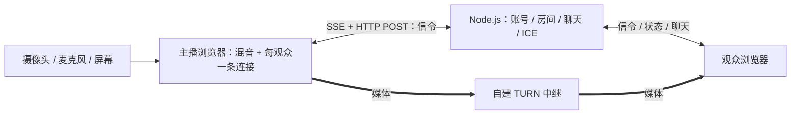

<div align="center">

# LUMA Live

**轻量、浏览器原生的实时直播间**

不需要 OBS、RTMP 或转码服务：打开浏览器即可开播，把链接分享给观众。

<p>
  <a href="https://github.com/ko2en/luma-live/blob/main/LICENSE"></a>
  
  
  
</p>

[快速开始](#快速开始) · [核心能力](#核心能力) · [工作原理](#工作原理) · [配置](#配置) · [验证](#验证) · [路线图](#路线图)

</div>

> [!IMPORTANT]
> LUMA Live 面向小范围分享，不是大规模直播平台。主播会为**每位观众分别发送一份媒体流**，实际承载能力取决于主播上行、设备、网络和 TURN 中继带宽。

## 一句话介绍

LUMA Live 是一个 Node.js + WebRTC 的轻量直播项目：主播在浏览器中采集摄像头、麦克风或屏幕，观众用浏览器观看并聊天；Node.js 服务端负责登录、房间状态、信令和 ICE 配置，媒体通过自建 TURN 中继传输。

## 核心能力

- **浏览器直接开播**：摄像头、麦克风、屏幕共享与 WebAudio 混音。
- **链接观看**：观众无需安装客户端，浏览器即可播放和聊天。
- **强制 TURN 中继**：媒体不建立浏览器直连，也不静默回退到直连。
- **单主播保护**：同一账号只允许一处开播，接管过程有明确提示。
- **账号与会话**：首次启动从 `AUTH_USERS` 写入账号库，支持网页登录、自助改密和头像。
- **轻量信令**：使用 SSE + HTTP POST 处理信令、房间、聊天和断线宽限。
- **固定发送档位**：统一以 1280×720、30 fps、最高 1.2 Mbps 向每位观众发送。
- **零第三方运行时依赖**：服务端使用 Node.js 内置能力，适合自托管和快速试用。

## 快速开始

### Windows

1. 从 GitHub 选择 **Code → Download ZIP** 并完整解压（不要在压缩包内运行）。
2. 确认目录中包含 `server.js` 和 `start.bat`，双击 `start.bat`。
3. 如果没有 Node.js，按提示安装 **Node.js LTS（≥18）** 后重新运行。
4. 打开 <http://localhost:3000/login> 登录，再进入开播台并授权摄像头、麦克风。
5. 局域网观众可访问 `http://<运行服务的内网IP>:3000/`。

也可以在项目目录执行：

```powershell
node server.js
```

### macOS / Linux

```bash
git clone https://github.com/ko2en/luma-live.git
cd luma-live
AUTH_USERS="主播:请替换为强密码" bash start.sh
```

启动后：

- 登录页：<http://localhost:3000/login>
- 开播台：<http://localhost:3000/studio>
- 观众页：<http://localhost:3000/>

### Docker

```bash
docker build -t luma-live .
docker run --rm -p 3000:3000 \
  -e AUTH_USERS="主播:请替换为强密码" \
  -e TURN_LINES="hk|turn.example.com|23478|secret|香港" \
  -v luma-data:/app/data \
  luma-live
```

### 部署前必读

- 摄像头和麦克风采集要求开播端运行在 **`localhost` 或 HTTPS**。
- 跨网络观看需要公网可达的 TURN 服务；能打开网页不代表媒体链路一定连通。
- 公网部署务必配置 `AUTH_USERS`，或在无账号鉴权的旧部署中配置 `STREAM_KEY`。两者都没有时，鉴权会关闭。
- 请使用强密码，并将 `AUTH_SECRET`、TURN secret 等敏感值放在环境变量或密钥管理系统中。
- 关闭 Node.js 进程或主播页面可能导致直播结束；主播信令短暂断线默认有 10 秒重连宽限。

## 界面预览

| 开播控制台 | 观众页 |
| --- | --- |
|  |  |

窄屏观众页会从播放器 + 聊天双栏切换为单列布局。

## 工作原理



### 关键设计

- **信令**：`GET /api/events` 接收事件，`POST /api/signal` 投递信令；连接池共用心跳，状态广播采用合并窗口。
- **媒体**：主播为每位观众建立独立 WebRTC 连接；服务端只负责信令和配置，不处理媒体转码。
- **强制中继**：浏览器使用 `iceTransportPolicy: relay`，`iceServers` 只下发配置的 TURN（UDP + TCP）。中继不可用时直接失败。
- **临时凭证**：coturn REST 凭证由服务端现签，客户端只拿到限时凭证。
- **账号安全**：登录 cookie 为 HttpOnly；失败次数按来源 IP 限制，连续失败达到阈值后暂时锁定。
- **重连与接管**：主播信令断开后进入宽限期；新开播台接管时，旧页面收到 `host-taken` 后停止推流和自动重连。

## 与 Owncast 的定位区别

项目灵感来自 [Owncast](https://github.com/owncast/owncast)，但两者媒体路径不同：

| | LUMA Live | Owncast 路线 |
| --- | --- | --- |
| 开播入口 | 浏览器采集 | 推流工具向服务器推流 |
| 媒体分发 | 主播逐观众经 TURN 中继 | 服务端处理并分发媒体 |
| 主要容量约束 | 主播上行、设备、连接数与中继带宽 | 服务端处理与分发资源 |
| 适用场景 | 小范围、低部署成本的实时分享 | 需要服务端媒体分发的直播场景 |

## 配置

全部通过环境变量控制。公网部署至少设置 `AUTH_USERS`（或兼容旧部署的 `STREAM_KEY`）和 `TURN_LINES`。

| 变量 | 默认值 | 作用 |
| --- | --- | --- |
| `PORT` | `3000` | 应用监听端口 |
| `AUTH_USERS` | 空 | 初始账号：`用户名:密码[,用户名:密码...]`，首次启动写入 `data/users.json` |
| `AUTH_SECRET` | 空 | 会话签名密钥；不设置时重启后需重新登录 |
| `AUTH_TTL_SEC` | `2592000` | 登录有效期（秒，最小 1 小时） |
| `AUTH_MAX_FAILS` | `5` | 连续登录失败次数阈值 |
| `AUTH_LOCK_MS` | `60000` | 登录锁定时长（毫秒） |
| `COOKIE_SECURE` | 未设置 | HTTPS 部署时设为 `1`，cookie 仅走加密连接 |
| `STREAM_KEY` | 空 | 未配置账号时的兼容开播口令 |
| `LUMA_DATA_DIR` | `./data` | 账号库与头像目录 |
| `HOST_GRACE_MS` | `10000` | 主播信令断线宽限期（毫秒） |
| `CHAT_MIN_INTERVAL` | `350` | 单连接聊天最小间隔（毫秒） |
| `TRUST_PROXY` | 未设置 | 可信反向代理后设为 `1`，读取 `X-Forwarded-For` |
| `TURN_LINES` | 空 | `id\|host\|port\|secret\|标题`，多条逗号分隔；当前只使用第一条 |
| `TURN_DEFAULT` | 第一条线路 | 兼容旧配置，实际固定使用 `TURN_LINES` 第一条 |

示例：

```bash
TURN_LINES="hk|turn.example.com|23478|secret|香港"
```

> `TRUST_PROXY=1` 只能用于可信反向代理之后。否则客户端可能伪造来源 IP，影响登录限速与审计。

## 验证

```bash
npm test              # API 回归：认证、限速、信令、聊天、重连与 ICE
npm run test:video    # 发送参数与画质
npm run test:relay    # relay 候选与中继识别
npm run test:e2e      # 开播、观看、刷新重连
npm run test:studio   # 开播口令流程
```

测试通过只代表对应场景通过，不等于完成跨浏览器、跨网络或生产容量验证。

## 已知限制

- 主播为每位观众单独发送媒体，主播上行和设备编码能力是主要瓶颈。
- TURN 中继需要独立服务器带宽，且可能被特定网络策略阻断。
- 房间与连接状态保存在内存中，服务重启后需要重新开播。
- 当前没有录像回看、逐观众自适应码率或 SFU 分发模式。
- SSE 凭证、共享设备本地存储和公网防护仍值得进一步加固。

如果目标是大规模观看，建议评估 mediasoup、LiveKit 等 SFU，或完整的服务端媒体分发架构，而不是只提高信令服务配置。

## 目录结构

```text
server.js              静态服务、账号会话、SSE、信令、聊天、房间状态与 ICE 下发
public/                 登录页、观众页、开播台与前端逻辑
scripts/                API 与浏览器回归测试
start.bat / start.sh    Windows / macOS / Linux 启动入口
Dockerfile              容器构建配置
docs/                   README 截图
data/                   运行时生成的账号库与头像（不入库）
```

## 路线图

- [x] 账号登录、失败限速与自助改密
- [x] 信令方向校验与连接身份检查
- [x] 主播信令断线宽限期
- [x] 单主播保护与接管流程
- [x] TURN 凭证下发与中继识别
- [x] 强制中继的固定发送参数
- [x] 公网 TURN 中继链路实测
- [ ] 逐观众自适应码率
- [ ] SSE 使用短期 token 取代 query 中的凭证
- [ ] 录像与回看
- [ ] 可选 SFU 模式

## 贡献与反馈

欢迎通过 Issue 反馈问题或提出改进建议。提交前请附上 Node.js 版本、部署方式、浏览器、网络环境和可复现步骤；请勿在 Issue 中公开账号、密码、TURN secret 或 cookie。

## License

本项目基于 [MIT License](LICENSE) 发布。
