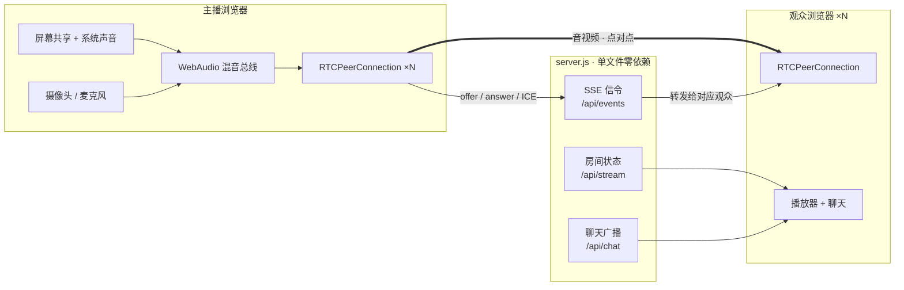

<div align="center">

# LUMA Live

**浏览器互连的直播间 · 打开一个网页就能开播**

不需要 OBS · 不需要 RTMP · 不需要转码服务器

<br>


<br>

[工作原理](#工作原理) · [快速开始](#快速开始) · [已知限制](#已知限制)

</div>


## 这是什么

主播打开 `/studio`，点一下「开始直播」，摄像头画面立刻进直播间；观众打开链接就能看，还能实时聊天。

**音视频不经过服务器**——主播和每个观众之间直接建立 WebRTC 点对点连接。服务器只做三件事：转发信令、维护房间状态、广播聊天消息。所以一台 1 核 512MB 的小机器就能撑起一整场直播。

```
主播浏览器 ──────── WebRTC 音视频直连 ────────▶ 观众浏览器
     │                                              ▲
     │  信令 / 状态 / 聊天（KB 级，走服务器）          │
     └──────────────▶  server.js  ──────────────────┘
```

## 和 Owncast 有什么区别

项目灵感来自 [Owncast](https://github.com/owncast/owncast)，但技术路线完全不同——它是一条"推流管线"，这是一条"电话总机"。

|  | Owncast | LUMA Live |
|---|---|---|
| 开播方式 | OBS 推 RTMP 到服务器 | **浏览器点按钮** |
| 媒体路径 | 服务器收流 → ffmpeg 转码 → HLS 分发 | **浏览器 ↔ 浏览器直连** |
| 延迟 | 10–30 秒（HLS） | **< 1 秒** |
| 服务器带宽 | 每个观众 1–3 Mbps | **接近 0** |
| 观众规模 | 看 CDN，轻松上千 | 约 150（受并发长连接限制） |
| 回看 / 录像 | 支持 | 不支持 |
| 播放端 | 任何播放器 / 手机 | 只能是浏览器 |

一句话：**Owncast 是能运营的直播平台，LUMA Live 是打开就能用的房间。**

## 工作原理



## 三个值得一看的实现

**1. 用 SSE 而不是 WebSocket 做信令**
`GET /api/events` 是普通 HTTP 长连接，穿反向代理、企业网关、CDN 都不需要额外配置；断开后浏览器自动重连。配合 `POST /api/signal` 做单向投递，实现起来比 WebSocket 简单一个数量级。全服务端共用一个 20 秒心跳定时器，而不是每个连接一个。

**2. WebAudio 混音总线，把两路音频合成一条**
麦克风和屏幕共享通常各自带一条音轨。直接二选一会丢掉系统声音（播放视频时观众听不到），推两条轨又要处理协商。做法是在前端建一条混音总线：

```js
micSource → micGain ┐
                    ├→ masterGain → MediaStreamAudioDestination → 单条 program 音轨
screenSource → screenGain ┘
```

静音用 `gain` 渐变而不是 `stop()`，避免重新协商；直播中开停屏幕共享也能无感切换。

**3. 服务端扇出：把 O(N²) 压回 O(N)**
观众成批涌入时，每个新人触发一次全量状态广播，就是 O(N²)。改成 200ms 合并窗口 + 一次 `flush`，同时把广播改成预构造 frame 后直接遍历连接池。2000 个连接建立时间从 **42 秒降到 1.8 秒**，单条消息扇出中位数 **11ms**。

## 快速开始

```bash
git clone https://github.com/ko2en/luma-live.git
cd luma-live
node server.js
```

无需 `npm install`——整个项目零依赖。

| 地址 | 用途 |
|---|---|
| `http://localhost:3000/studio` | 开播控制台 |
| `http://localhost:3000/` | 观众页 |

> 摄像头和麦克风采集要求**安全上下文**：`localhost` 或 HTTPS。部署到服务器时记得配证书。
> 屏幕共享的**系统声音**只有 Chrome / Edge 支持，且共享「标签页」时才会带上音频。

观众打开后看到的是这样——左侧播放器，右侧实时聊天，手机浏览器自动切成单列：


## 目录结构

```
server.js            静态文件 + SSE 信令 + 聊天 + 房间状态（404 行）
public/
  index.html         观众页
  studio.html        开播控制台
  viewer.js          播放器 + 信令客户端 + 聊天
  studio.js          采集、混音、逐观众建连、设备热切换
  styles.css         全部样式
docs/                README 用的截图
```

## 已知限制

这套架构用「省带宽」换掉了「兜底能力」，边界很清楚：

| 限制 | 原因 | 缓解方式 |
|---|---|---|
| 约 150 人同时在线 | 托管层单实例并发长连接配额 | 换更大的实例 / 前置 CDN |
| 对称 NAT 下黑屏 | 没有 TURN 中继，P2P 打不通就无解 | 加 coturn |
| 主播上行 = 观众数 × 码率 | 每个观众一份独立编码 | 家用宽带约 10 人上限 |
| 无回看、无录制 | 不落盘 | 需要单独做录制链路 |
| 重启丢状态 | 全内存实现 | 主播需保持页面打开 |

要突破人数上限，必须换成 SFU（mediasoup / LiveKit）——由服务器分发而不是主播逐份推。这不是调参能解决的。

## 路线图

- [ ] TURN 中继（解决对称 NAT 黑屏）
- [ ] 码率分档：360p / 540p / 720p 按观众网络自适应
- [ ] 录像与回看（MediaRecorder 落盘）
- [ ] 可选 SFU 模式，突破点对点人数上限

## License

[MIT](LICENSE)
